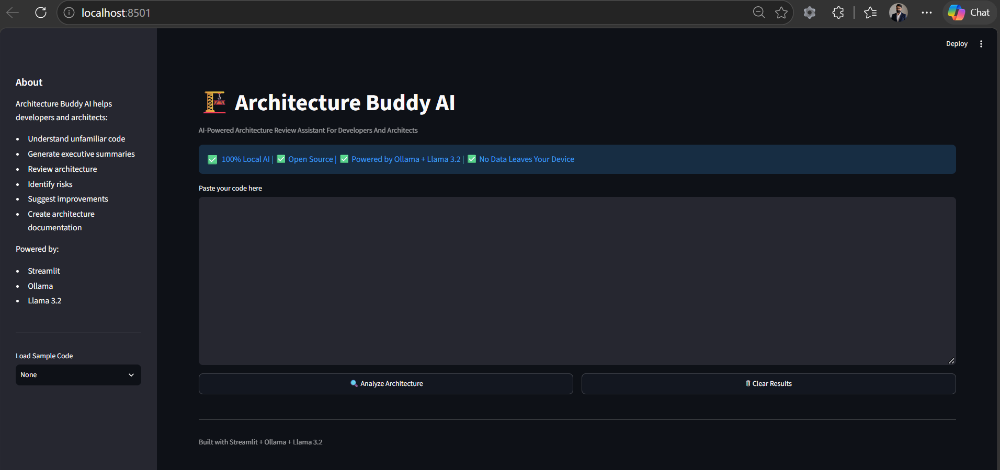
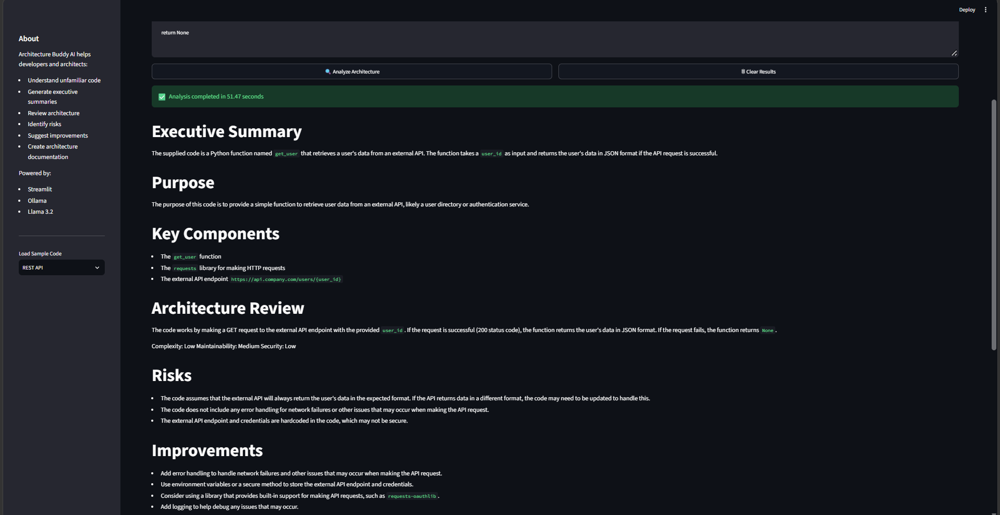
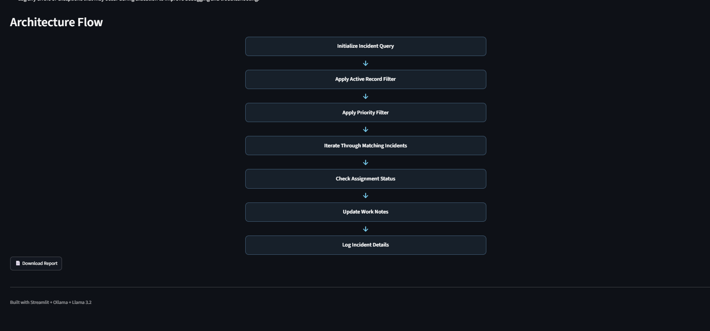

# 🏗️ Architecture Buddy AI

### Local AI-Powered Architecture Review Assistant for Developers and Architects

Architecture Buddy AI is a fully local, open-source application that helps developers and architects understand unfamiliar source code.

The application analyzes supplied code and generates a structured architecture report containing:

- Executive summary
- Code purpose
- Detected technology
- Key components
- Architecture review
- Complexity, maintainability, and security assessments
- Technical risks
- Recommended improvements
- Visual architecture flow
- Downloadable Markdown report

Architecture Buddy AI is built with **Python**, **Streamlit**, **Ollama**, and **Llama 3.2**. Code analysis runs locally through Ollama, helping users review source code without sending it to an external AI API.

---

## 🎯 Problem Statement

Developers and architects often spend significant time understanding legacy systems, undocumented implementations, unfamiliar scripts, and inherited codebases.

Traditional cloud-based AI tools may also require source code to be sent outside the local development environment.

Architecture Buddy AI addresses these challenges by providing a lightweight, local architecture-review assistant that can:

- Explain what unfamiliar code does
- Identify important technical components
- Review architecture and execution behavior
- Highlight potential risks
- Recommend practical improvements
- Generate an easy-to-understand execution flow
- Produce reusable architecture documentation

---

## 🚀 Features

- ✅ Local source-code analysis
- ✅ Structured AI-generated reports
- ✅ Executive summary generation
- ✅ Code-purpose explanation
- ✅ Technology detection
- ✅ Key-component identification
- ✅ Architecture review
- ✅ Complexity assessment
- ✅ Maintainability assessment
- ✅ Security assessment
- ✅ Risk identification
- ✅ Practical improvement recommendations
- ✅ Visual architecture-flow generation
- ✅ Markdown report download
- ✅ Built-in sample code
- ✅ Session-state persistence
- ✅ No external AI API required

---

## 🧠 Designed Analysis Types

Architecture Buddy AI currently includes sample code and prompt guidance for:

- ServiceNow server-side scripting
- Python
- JavaScript
- REST API integrations
- Similar enterprise application code

The quality and accuracy of the report depend on the supplied code, available context, and the local AI model.

---

## 🏗️ How It Works

```text
+------------------------+
| User Supplies Code     |
+------------------------+
            |
            v
+------------------------+
| Streamlit Application  |
+------------------------+
            |
            v
+------------------------+
| Structured AI Prompt   |
+------------------------+
            |
            v
+------------------------+
| Ollama + Llama 3.2     |
+------------------------+
            |
            v
+------------------------+
| Structured JSON Result |
+------------------------+
            |
            v
+------------------------+
| Streamlit Report       |
| and Visual Flow        |
+------------------------+
            |
            v
+------------------------+
| Markdown Download      |
+------------------------+
```

The AI model returns a structured response. Streamlit separately renders the architecture review, assessment values, risks, improvements, and architecture-flow boxes.

This approach prevents the architecture flow from being returned as an inconsistent or unreadable single-line diagram.

---

## 🛠️ Technology Stack

- **Python**: Application language
- **Streamlit**: User interface and report rendering
- **Ollama**: Local model runtime
- **Llama 3.2**: Local language model
- **JSON**: Structured AI response format
- **Markdown**: Downloadable report format

---

## 📸 Application Screenshots

### Home and Analysis Screen

The application provides a code-input area, sample-code selector, analysis button, clear-results button, privacy message, and generated report.



---

### Architecture Review and Assessment

The generated report includes architecture observations, complexity, maintainability, security, risks, and recommended improvements.





---

### Visual Architecture Flow

The application converts AI-generated execution steps into a consistent vertical architecture flow rendered by Streamlit.

screenshot/architectureflow.png

> Ensure the `screenshot` folder and all three image files are committed to the repository using the exact filenames shown above.

---

## 📌 Included Sample Code

The sidebar includes selectable sample code for ServiceNow, Python, and REST API analysis.

### ServiceNow GlideRecord Sample

```javascript
var gr = new GlideRecord('incident');

gr.addActiveQuery();
gr.addQuery('priority', 1);
gr.query();

while (gr.next()) {
    gs.info(
        gr.number + ' - ' +
        gr.short_description
    );

    if (gr.assigned_to.nil()) {
        gr.work_notes =
            'Auto review detected unassigned incident';

        gr.update();
    }
}
```

This sample demonstrates:

- GlideRecord initialization
- Active-record filtering
- Priority filtering
- Incident-query execution
- Result iteration
- Assignment-status evaluation
- Work-note updates
- Incident logging

---

### Python Function Sample

```python
def calculate_total(price, qty):
    if qty <= 0:
        raise ValueError(
            "Quantity must be positive"
        )

    return price * qty


amount = calculate_total(100, 5)
print(amount)
```

This sample demonstrates:

- Function definition
- Input validation
- Exception handling
- Calculation logic
- Function invocation

---

### REST API Sample

```python
import requests


def get_user(user_id):
    response = requests.get(
        f"https://api.company.com/users/{user_id}",
        timeout=10
    )

    if response.status_code == 200:
        return response.json()

    return None
```

This sample demonstrates:

- REST API communication
- Dynamic endpoint construction
- HTTP response evaluation
- JSON response handling
- Request timeout configuration

---

## 💡 Generated Report Sections

### Executive Summary

Provides a concise overview of the supplied code.

### Purpose

Explains the intended purpose and observable behavior of the code.

### Detected Technology

Identifies the technology or platform based on evidence visible in the supplied code.

### Key Components

Identifies important functions, APIs, platform features, data sources, filters, and operations.

### Architecture Review

Provides concise architecture observations covering:

- Data access
- Query and filtering behavior
- Processing logic
- Decision points
- Record updates or responses
- Maintainability
- Performance
- Scalability
- Security

### Assessment

Classifies the following areas as **Low**, **Medium**, or **High**:

- Complexity
- Maintainability
- Security

For maintainability and security, a higher rating indicates a stronger implementation.

### Risks

Highlights potential technical, performance, maintainability, and security concerns supported by visible code behavior.

### Improvements

Suggests practical and technology-specific improvements.

### Architecture Flow

Displays the execution sequence as a consistent visual flow generated from structured model output.

### Downloadable Report

Allows the generated analysis to be downloaded as a Markdown file.

---

## ⚙️ Prerequisites

Before running Architecture Buddy AI, install:

- Python 3.10 or later
- Git
- Ollama
- Visual Studio Code or another code editor

The Llama 3.2 model must also be available locally through Ollama.

---

## 📥 Installation

### 1. Clone the Repository

```bash
git clone https://github.com/vhudlikar/architecture-buddy.git
```

### 2. Navigate to the Project Directory

```bash
cd architecture-buddy
```

### 3. Create a Virtual Environment

#### Windows PowerShell

```powershell
python -m venv .venv
.venv\Scripts\Activate.ps1
```

#### macOS or Linux

```bash
python3 -m venv .venv
source .venv/bin/activate
```

### 4. Install Python Dependencies

```bash
pip install -r requirements.txt
```

### 5. Install Ollama

Download and install Ollama from:

https://ollama.com/download

### 6. Pull the Llama 3.2 Model

```bash
ollama pull llama3.2
```

### 7. Verify the Model

```bash
ollama list
```

Confirm that `llama3.2` appears in the installed-model list.

### 8. Run the Application

```bash
streamlit run app.py
```

Streamlit will display the local application URL in the terminal.

---

## 📄 Requirements

The `requirements.txt` file should contain:

```text
streamlit
ollama
```

---

## 📂 Suggested Project Structure

```text
architecture-buddy/
│
├── app.py
├── README.md
├── requirements.txt
├── LICENSE
│
└── screenshot/
    ├── homescreen.png
    ├── analysis-report.png
    └── architectureflow.png
```

---

## ▶️ Using the Application

1. Start Ollama.
2. Run the Streamlit application.
3. Paste source code into the input area or select a sample from the sidebar.
4. If a sample is selected, click **Load Selected Sample**.
5. Click **Analyze Architecture**.
6. Wait for the local model to generate the structured analysis.
7. Review the report and visual architecture flow.
8. Click **Download Report** to save the result as Markdown.
9. Click **Clear Results** before beginning a new analysis if required.

---

## 🔒 Privacy-First Processing

Architecture Buddy AI is designed to process supplied code locally through Ollama.

### Benefits

- Source code is processed on the local machine
- No external AI API key is required
- No per-request cloud API cost
- No source-code upload to an external AI service
- Suitable for private local demonstrations and experimentation
- Helpful for privacy-conscious development workflows

Users should still follow organizational security, data-handling, and source-code policies before analyzing proprietary or sensitive code.

---

## ⚠️ Current Limitations

Architecture Buddy AI is a hackathon prototype and should be treated as an architecture-assistance tool, not as an automated approval mechanism.

Current limitations include:

- Output quality depends on the supplied code and available context
- Small local models may occasionally generate inaccurate assumptions
- Ratings are qualitative AI assessments, not formal security scores
- The application does not execute the supplied source code
- The application does not perform static-code analysis
- The application does not inspect complete repositories
- The application does not replace manual architecture or security review
- Generated recommendations should be validated by an experienced developer or architect

---

## 🚀 Future Enhancements

- Repository and multi-file analysis
- Larger local-model support
- Selectable local-model configuration
- Technology-specific review templates
- ServiceNow-specific analysis modes
- Architecture-pattern detection
- Security-focused review profiles
- Export to PDF
- Side-by-side code and recommendation view
- Report history
- Improved rating explanations
- Automated validation of generated observations
- Multi-language support

---

## 🏆 Hackathon Project

Architecture Buddy AI was created as an open-source AI hackathon project demonstrating how local language models can help developers and architects understand and document software implementations while keeping analysis on the local machine.

The project focuses on three key ideas:

1. **Privacy**: Code analysis runs locally.
2. **Accessibility**: The application uses a lightweight Streamlit interface.
3. **Practicality**: The generated output is structured for architecture review and documentation.

---

## 👨‍💻 Author

**Viraj Hudlikar**

ServiceNow Architect | AI Enthusiast | Open-Source Contributor

GitHub: https://github.com/vhudlikar

---

## 🤝 Contributing

Contributions, suggestions, and issue reports are welcome.

To contribute:

1. Fork the repository.
2. Create a feature branch.
3. Make and test the changes.
4. Commit the changes.
5. Push the feature branch.
6. Create a pull request.

---

## 📜 License

This project is available under the MIT License.

See the `LICENSE` file for additional details.

---

⭐ If Architecture Buddy AI is useful, consider starring the repository.